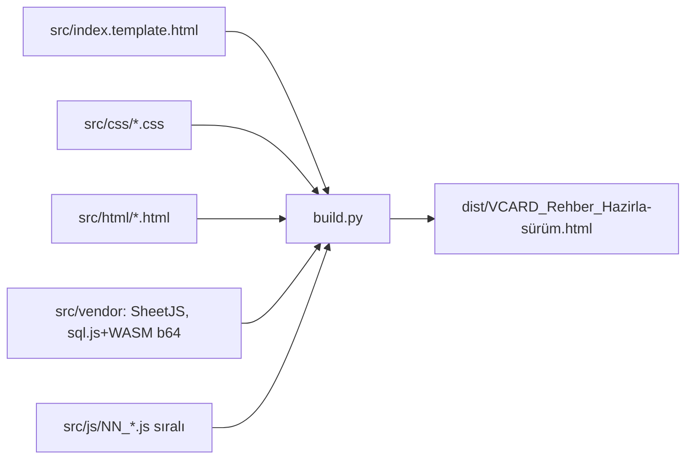
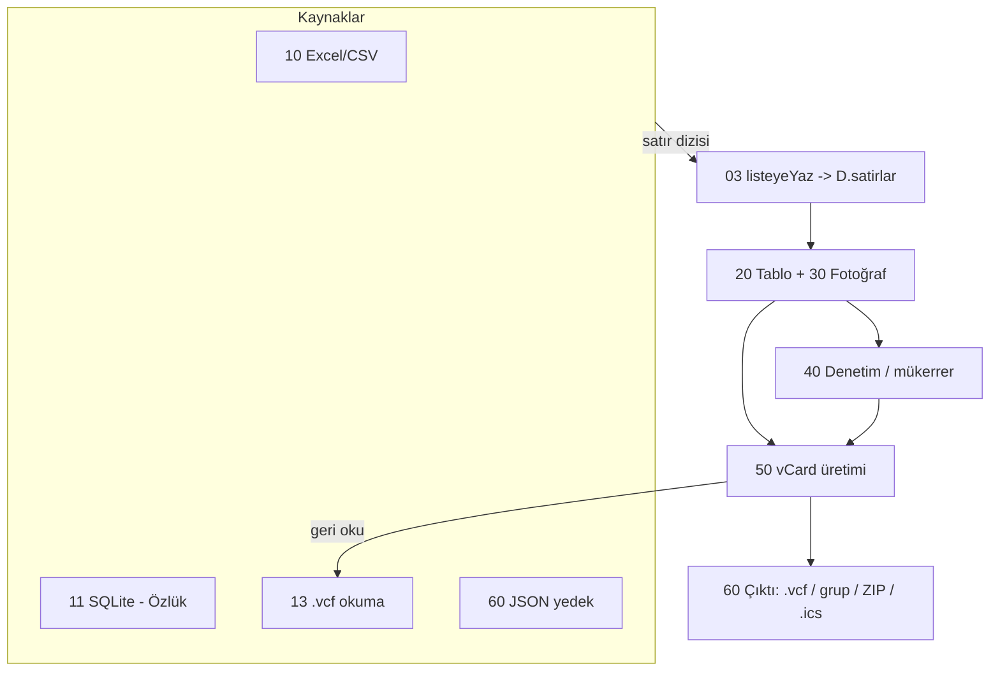
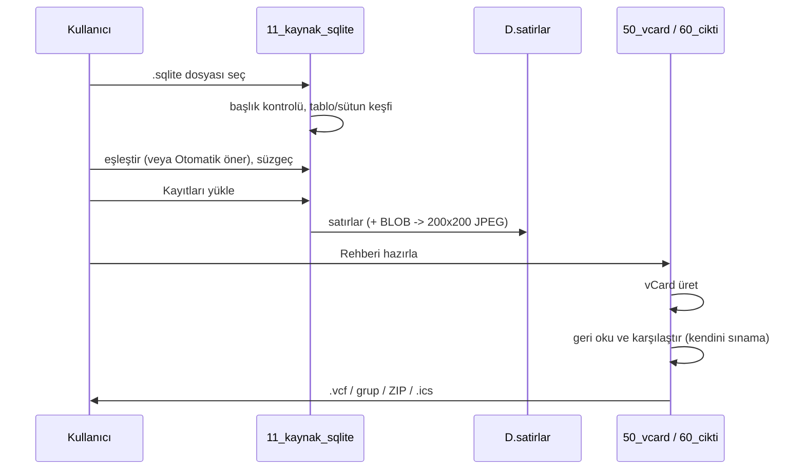

# Mimari

## 1. Derleme

`build.py` yalnızca standart kütüphane kullanır. Şablondaki `{{INCLUDE:yol}}` ve `{{INCLUDE:klasor/*.ext}}` (ada göre sıralı) genişletilir; `{{APP_SURUM}}` `01_sabitler.js`'ten okunur. Vendor dosyalarında `</script>` bulunmamalıdır (kontrol edilmiştir).

## 2. Katmanlar

Tüm kaynaklar **aynı biçimde** satır üretir; sonrasındaki her şey (tablo, denetim, üretim) kaynaktan bağımsızdır. Bu, ileride SQL Server kaynağı eklenirken dokunulacak tek yerin kaynak modülü olmasını sağlar.

## 3. Veri modeli

Bellekteki tek durum `D` (`03_durum.js`):

| Alan | Anlam |
|---|---|
| `D.satirlar` | Kişi dizisi. Her kişi: `name, disp, cell, work, fax, home, mail, addr, org, title, url, cat, photo, bday` (hepsi metin) + `_img` (200×200 JPEG dataURL veya `null`) |
| `D.sayfa`, `D.sayfaBoyu` | Tablo sayfalama |
| `D.vcf` | Son üretilen vCard metni |
| `D.wb` | Son okunan Excel çalışma kitabı |
| `D.sq` | `{db, tablolar:{ad:[sütunlar]}, tablo}` — açık SQLite veritabanı |

Kurallar: `bday` her zaman `YYYYMMDD` ya da boş; geçersiz değer olduğu gibi tutulur ve işaretlenir (yazılmaz). `_img` yalnızca bellekte; otomatik saklamaya yazılmaz.

### Alan → vCard eşlemesi (`ALANLAR`, `TEL_ONEK`, `vcfKart`)

| Alan | 2.1 | 3.0 | 4.0 |
|---|---|---|---|
| name | `N;…QP:aile;ad;;;` | `N:aile;ad;;;` | `N:aile;ad;;;` |
| disp | `FN;…QP` | `FN` | `FN` |
| cell/work/fax/home | `TEL;CELL`, `TEL;WORK`, `TEL;WORK;FAX;PREF`, `TEL;HOME` | `TEL;TYPE=…` | `TEL;TYPE=cell/work/work,fax/home` |
| mail | `EMAIL;PREF;INTERNET` | `EMAIL;TYPE=INTERNET,PREF` | `EMAIL` |
| addr | `ADR;WORK;…QP:;;adres` | `ADR;TYPE=WORK:;;adres;;;;` | `ADR;TYPE=work:;;adres;;;;` |
| org/title/cat | QP | kaçışlı UTF-8 | kaçışlı UTF-8 |
| bday | `YYYYMMDD` | `YYYY-MM-DD` | `YYYYMMDD` |
| photo | `PHOTO;ENCODING=BASE64;JPEG:` + 76'lık satırlar + boş satır | `PHOTO;ENCODING=b;TYPE=JPEG:` (katlı) | `PHOTO:data:image/jpeg;base64,…` (katlı) |

## 4. Kaynak sözleşmesi

Bir kaynak modülü şunu yapar: kullanıcıdan veriyi alır, her kayıt için `bosSatir()` ile bir kişi nesnesi doldurur ve `listeyeYaz(satirlar, modOku())` çağırır (`mod`: `degistir` | `ekle`). Kaynak tarih değerlerini `bdayNorm`, metinleri `hucreMetni` ile normalize eder. Telefon biçimlendirme kaynakta yapılmaz (kontrol/üretim aşamasında yapılır).

Özlük (SQLite) kaynağının ek sözleşmesi:
- Yalnızca eşleştirilen (veya şablonda kullanılan) sütunlar `SELECT` edilir; hassas sütunlara (TC, kan grubu, ev adresi…) eşleştirilmedikçe dokunulmaz.
- Süzgeç ham SQL değil, (sütun, işlem, değer) üçlüsüdür ve parametreli çalışır.
- Şablon: `{sütun}` yer tutucuları; fotoğraf alanı için yalnızca gerçek BLOB sütunu görüntü sayılır.
- Dosya `SQLite format 3` ile başlamıyorsa (şifreli/bozuk) açılmaz ve kullanıcıya açıklama gösterilir.

## 5. Akışlar

**Özlük → .vcf**

**Kendini sınama:** `vcfUret` çıktısı `vcfOku` ile geri okunur; kişi sayısı, ad, telefonlar, e-posta, adres/kurum/unvan kaynakla karşılaştırılır. Fark varsa uyarı gösterilir.

## 6. Önemli tasarım kararları

- **QP kodlaması (2.1):** `=`, `;`, boşluk ve ASCII dışı baytlar `=XX`. `;` kodlanmazsa telefon adresi alanlara böler. Ayrıştırıcı bileşenli alanlarda (N, ADR, ORG) **önce böler, sonra çözer**.
- **Tarih:** Excel seri numarası UTC'ye göre çevrilir (yerel saat dilimiyle çevirmek bir gün kayma yaratır; v2 test geçmişinde yakalanmıştır).
- **Telefon:** 10 haneli → `+90`; `0`/`90`/`0090` önekleri temizlenir; `+` ile başlayan yabancı numaralar korunur; 3–6 haneli kısa/dahili numaralar olduğu gibi geçerlidir.
- **ZIP:** "store" yöntemiyle, harici kütüphanesiz yazılır (CRC32 + yerel/merkezi dizin; Türkçe dosya adı için UTF-8 bayrağı).
- **Bağımlılıksız dağıtım:** SheetJS ve sql.js(+WASM base64) dosyaya gömülüdür; `window.SQLWASM_B64` üzerinden `initSqlJs({wasmBinary})` ile başlatılır.
- **Test arayüzü:** `window.VCARD` yalnızca testler ve ileri kullanım içindir.

## 7. Saklanan anahtarlar (localStorage)

| Anahtar | İçerik |
|---|---|
| `vcard.eslesme.v1` | Kayıtlı alan eşleştirmeleri `{ad:{tablo,map}}` (yalnız sütun adları, veri yok) |
| `vcard.calisma.v1` | Yalnızca "Çalışmayı bu tarayıcıda sakla" işaretliyse: fotoğrafsız kişi listesi |
